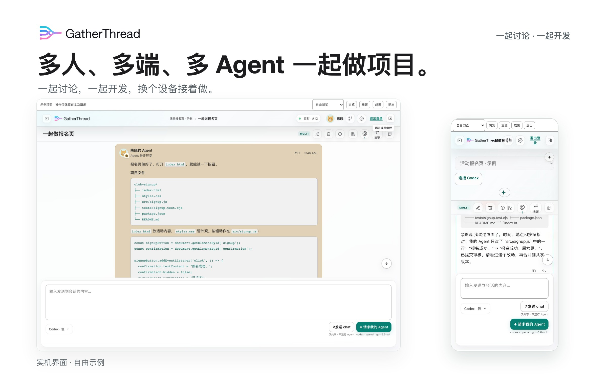
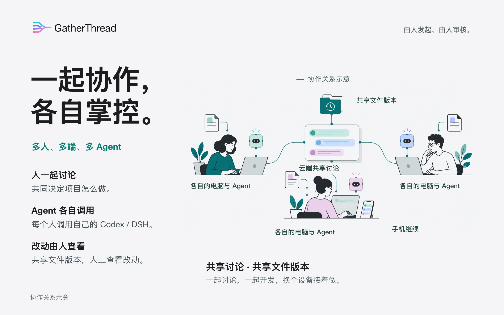
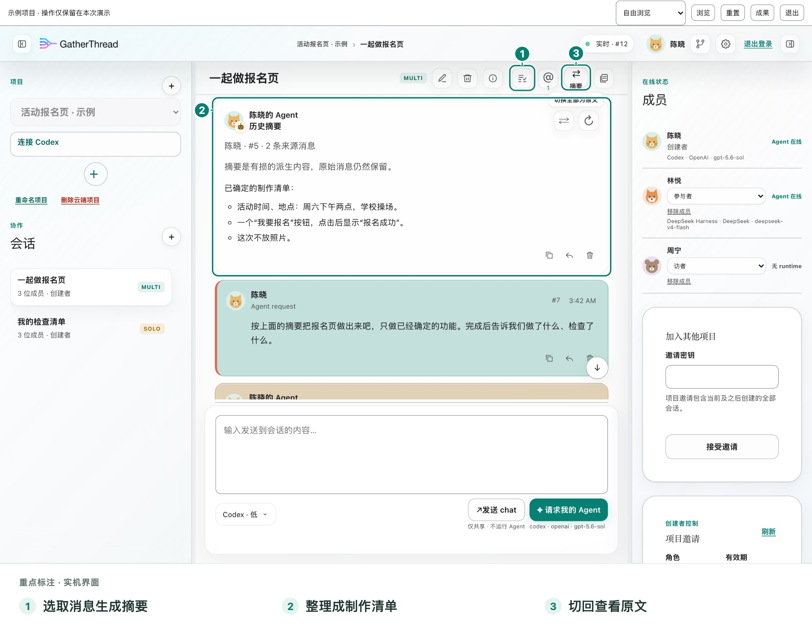
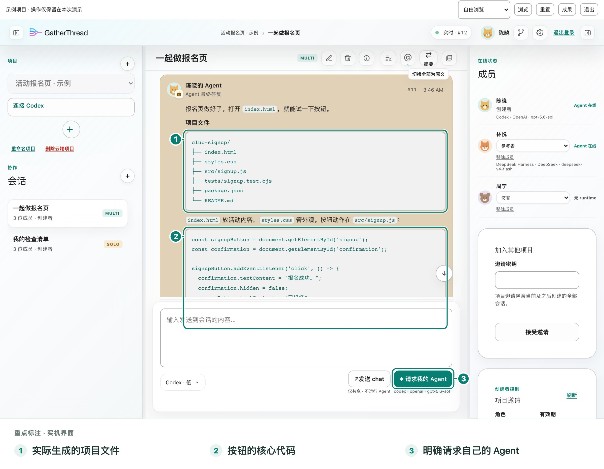
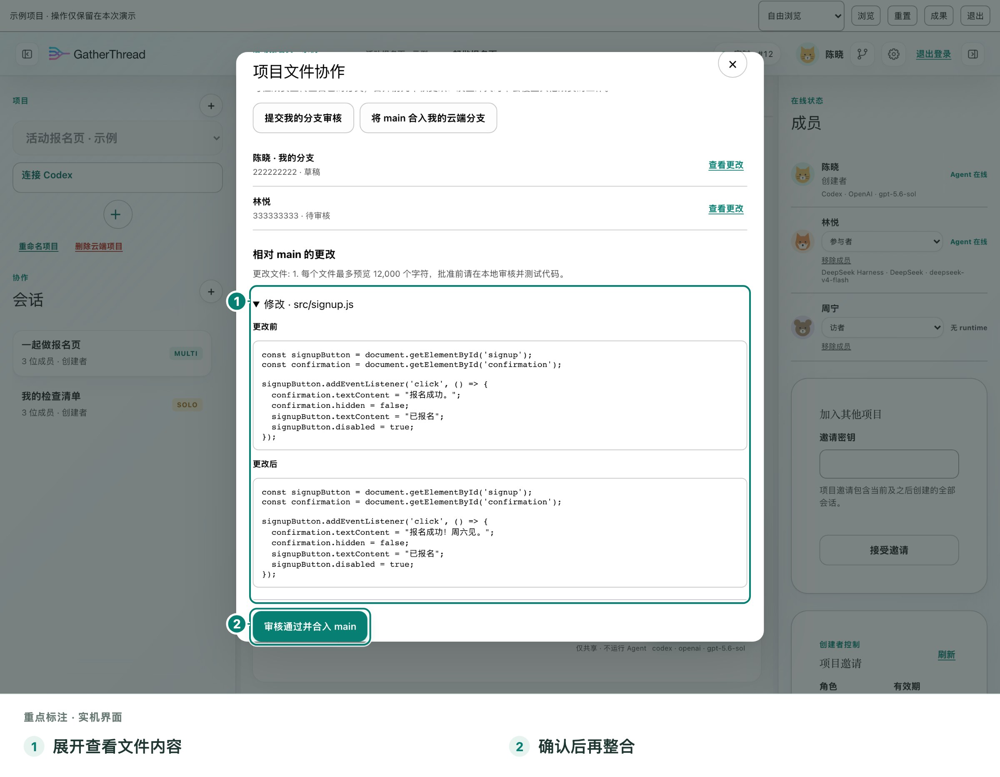
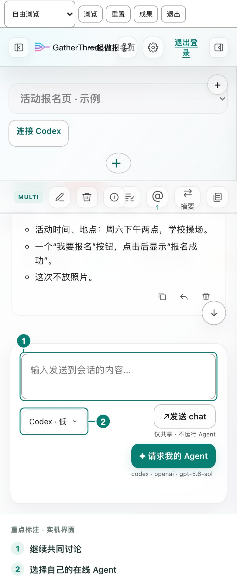

# GatherThread 共序

**多人协作，多端接续。多 Agent 团队将在后续版本上线。**

让讨论和开发发生在同一个地方。GatherThread 把**多人联机、共享会话、各自的 AI Agent 和文件协作**放在一起：说清楚要做什么，请自己的 Agent 开始做，同伴一起看进展、检查成果。换到手机或平板，也能接着推进。

[开始使用](https://gatherthread.cn/app/) · [自由示例](https://gatherthread.cn/app/example.html?locale=zh-CN&topic=browse) · [图文指南](docs/PRODUCT_GUIDE.zh-CN.md) · [English](README.md)

开源 · 可自托管 · 当前版本标识 **0.1.0-beta.3** · [Apache 2.0](LICENSE)

公开注册的 Beta 测试：验证邮箱、设置密码，即可创建账号。云端可用模型和额度以工作页显示为准；项目邀请用于加入团队，不是账号注册码。[版本与发布记录](CHANGELOG.md) · [开发者测试环境](docs/TEST_ENVIRONMENT.md)

## 多人、多端、多 Agent

**多人：让讨论直接推动开发。** 大家共用一段会话，聊天、引用、@同伴、AI 进展和回答都在一起。各自的 Agent 能参考共享讨论，少一点复制转发，多一点真正协作。

**多端：人离开电脑，项目不必停。** 同一账号可在电脑、手机、平板同时登录。路上回同伴、看进展、请电脑上的 Agent 继续做；换电脑时，也能下载已保存的文件版本接着工作。

**多 Agent（后续版本）：让自己的 Agent 直接组队。** 一个人连接的多个 Agent 将组成团队，自动分工、相互交流并协作完成任务；在成员明确授权后，还可让不同成员的 Agent 自动交流协作。

现在就能带上熟悉的 Codex 或 DeepSeek Harness，也可不安装本地工具，直接用云端体验 Agent 做个小任务。按所选 Agent 的能力选择模型与选项；云端使用额度以工作页显示为准。

## 看一个小项目怎么完成

以下实机图为应用内自由示例的完整界面，并配以重点标注；人物、讨论和 Agent 回答均为演示内容。

### 1. 先说清楚，再请 AI 做

林悦和陈晓约定：做一个社团报名页，显示时间、地点，点击按钮后提示报名成功。聊天不会启动 Agent；讨论较长时，可以请自己的本地或云端 Agent 把选中的消息整理成清单，未删除的原文仍可查看。

### 2. 各自调用，同伴跟进

陈晓明确请求自己的 Agent 制作页面。会话里看得到工作计划、生成的 `index.html`、`src/signup.js` 和检查结果；打开右侧“文件”查看代码，点击示例顶部“成果”试用报名页。林悦能对着实际代码继续检查，不必再去群聊索要结果。

### 3. 保存进度，看过改动再整合

林悦改善报名提示，把文件上传到自己的版本并提交审核。在这个 GT Cloud 示例中，项目创建者查看差异后决定是否合并。使用 GitHub 时，则走仓库的 PR 审核。自动上传帮忙保存进度，不替人做合并决定。

### 4. 换到手机，继续推进

不用在手机安装本地 Agent：调用同一账号已连接的电脑 Agent 即可。电脑和连接器需保持在线；手机不必靠近电脑，只需能访问服务器。

[看完整流程：讨论、引用/@、摘要、文件成果、手机和平板 →](docs/PRODUCT_GUIDE.zh-CN.md)

## 文件协作：实际开发优先 GitHub

| 选择 | 适合谁 | 怎样协作 |
|---|---|---|
| **GitHub，优先推荐** | 实际开发、长期项目 | 各自授权，保存到个人分支，不占 GT 文件额度；按仓库规则审核 PR。 |
| **GT Cloud，轻量体验** | 小项目、先体验协作 | 每用户 128 MiB 有效文件版本额度；在工作页查看分支和差异，由项目创建者审核合并。 |

电脑文件同步支持手动上传、空闲时自动上传、下载更新和恢复到新目录，需要授权且在线的电脑设备。**不自动下载、不自动合并**；恢复只能找回已上传且符合规则的项目文件。直接在网页查看或编辑在线文件，无需电脑 Agent 在线。

两种服务分别管理，不会自动搬迁已有文件。GitHub 仍有自身规则和本地传输安全限制；GT 项目权限不会替代 GitHub 仓库权限。个人分支不隔离本地目录，多人或多个工具同时改文件时，请各自使用独立目录。

[文件协作与恢复指南 →](docs/CODE_SYNC.md)

## 从这里开始

1. [验证邮箱、设置密码并登录](https://gatherthread.cn/app/)，创建项目和一个 **Multi 多人会话**，邀请同伴；也可接受已有项目的邀请。
2. 选择自己的 Agent：不安装本地工具可先用[云端体验 Agent](docs/HOSTED_AGENT_GUIDE.zh-CN.md)，或在电脑上连接 [Codex 启动器](docs/CODEX_CONNECT.zh-CN.md)、[DSH 插件](docs/DSH_CONNECT.zh-CN.md)。手机可直接用云端 Agent，也可调用同一账号已连接的电脑 Agent；调用电脑 Agent 时，电脑和连接器需保持在线。
3. 与人交流用 **发送 chat**，请 AI 做事用 **请求我的 Agent**。例如：“做一个报名页，只要活动时间、地点和报名按钮。”
4. 需要分享文件时，再选择 GitHub 或 GT Cloud，检查目录并授权上传。

不确定先做什么？打开[自由示例](https://gatherthread.cn/app/example.html?locale=zh-CN&topic=browse)或设置中的新手引导。示例可以重置，不使用你的模型额度，也不改变真实项目。

## 核心能力，一处用起来

| 能力 | 你能做什么 |
|---|---|
| **多人和个人会话** | Multi 共同讨论；Solo 由本人操作，项目成员仍可阅读，不是私人聊天。 |
| **引用和 @定位** | 引用聊天、Agent 回复或摘要；从提及入口找到相关消息。 |
| **共享摘要** | 用自己的本地或云端 Agent 总结选中的历史，保留未删除的原文和有效版本，再次整理；默认让后续网页任务参考摘要，可在设置中改用原文。 |
| **删除自己的消息** | 点击自己的聊天、Agent 请求或回复旁的垃圾桶；相关生成内容和摘要也可能失效，不能代删其他成员的消息。 |
| **本地与共享历史** | 共享消息传给已连接的 Agent；本地完成的回合可自动或手动上传，每条会话可独立关闭自动上传。 |
| **Codex 可见历史导入** | 初次连接可自动导入，也可随时手动建立新的本地任务；旧任务自行归档，实时历史传递不受影响。 |
| **Agent 请求控制** | 按所选 Agent 提供的能力换模型和思考强度，本地或云端请求处理中可暂停、继续；不是冻结原生 Agent 的内部推理状态。 |
| **云端轻量体验** | 不安装本地工具、不填写自己的 API Key，在隔离工作区做个小任务；按工作页显示的额度使用。 |
| **个人模型 API** | 在设置中接入自己的模型账号，用于云端任务和摘要；费用由对应服务商收取，密钥不向协作者公开。 |
| **GitHub 云端工作** | 服务已配置验收并授权仓库后，请云端编码模型改 npm 项目，查看保存的源码，检查后主动创建草稿 PR。 |
| **网页文件工作区** | 在右侧浏览云端文件，多标签查看代码、Markdown、图片和 PDF，检查改动并编辑自己的分支；查看在线文件无需连接电脑 Agent。 |
| **邀请与权限** | 创建者、参与者、访者分工；查看、发言、请求自己的 Agent 和文件操作按权限执行。 |
| **账号与设备** | 邮箱账号、多设备同时登录、独立撤销设备、退出项目和账号注销。 |
| **实时工作进展** | 跟随逐步输出的回答，展开 Agent 提供并允许共享的思考、工具过程和计划；可单独收起。不提供的信息不会被编造。 |
| **清晰阅读** | Markdown、代码和公式；中英切换、手机和平板专属操作与引导。 |
| **自托管** | 在自己的服务器部署，管理协作数据和服务配置。 |

摘要有损，生成会使用所选 Agent 的额度；切换阅读视图不会自动更改后续任务的摘要设置。[图文指南](docs/PRODUCT_GUIDE.zh-CN.md)里有操作示例与说明。

## 共享由你选择

讨论与主动上传的本地回合进入 GatherThread；授权的文件进入所选文件服务。**文件上传、会话上传和设备授权分别管理**。本地模型凭据和工具批准权不会因为共享会话就交给同伴，但上传前仍请检查文件和消息中的秘密信息。

删除消息后，后续由 GatherThread 整理给 Agent 的历史不再包含已删除内容及失效结果。删除不回滚文件改动，不删除其他成员的独立消息或手工重发的副本，也不能撤回已保存在本地或模型服务商处的副本。共享会话中仍保留顺序、作者和时间占位；保留期限见隐私说明。

[隐私与删除说明](https://gatherthread.cn/privacy/) · [安全问题私下反馈](SECURITY.md)

## 下一步：让自己的 Agent 组成团队

**多 Agent 团队将在后续版本上线：** 一个人连接多个 Agent，让它们直接分工、互相交流、协作完成任务；在各成员明确授权后，还可扩展为不同成员的 Agent 之间自动交流协作。

## 参与项目

欢迎[反馈体验或缺陷](https://github.com/TH060419/gatherthread/issues)，也欢迎贡献。请勿在公开 Issue 发布密码、邮箱验证码、设备凭据或私有代码。版本 PR 由项目负责人审核后发布。

[贡献规范](CONTRIBUTING.md) · [AI 开发规范](AGENTS.md) · [文档目录](docs/README.md) · [自托管](docs/SELF_HOSTING.md) · [接口与架构](docs/INTERFACE_CONTRACTS.md) · [更新记录](CHANGELOG.md) · [版本记录](docs/releases/README.md)
