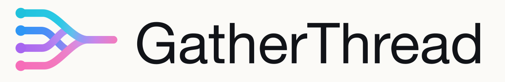

# GatherThread approved logo assets · final F

This directory is the canonical logo package for all GatherThread contributors. Use the approved **final F** assets as delivered; select the correct background variant below. The mark and outlined wordmark are fixed masters, not examples to redraw.

本目录以用户最终确认的 **F 版**为唯一生产标准。四条输入线、外侧连续平滑曲线、中间两条线的隐藏关系、右侧短水平渐变线，以及 `GatherThread` 字标均保留已确认的矢量形状。上传和共享时未重画图形或替换字标。

## Select the right asset / 正确选用

文件名中的 `transparent-light` / `transparent-dark` 表示**放置它的背景**，不是图形颜色。浅色背景横版配深色字标；深色背景横版配白色字标。独立彩色图形的两个透明版本内容一致。

| 用途 / Use | SVG |
| --- | --- |
| 浅色背景上的透明横版 / Light surface | [`lockup-color-transparent-light.svg`](svg/lockup-color-transparent-light.svg) |
| 深色背景上的透明横版 / Dark surface | [`lockup-color-transparent-dark.svg`](svg/lockup-color-transparent-dark.svg) |
| 自带浅色背景的横版 / Baked light background | [`lockup-color-on-white.svg`](svg/lockup-color-on-white.svg) |
| 自带深色背景的横版 / Baked dark background | [`lockup-color-on-dark.svg`](svg/lockup-color-on-dark.svg) |
| 独立彩色图形 / Mark only | [`mark-color-transparent-light.svg`](svg/mark-color-transparent-light.svg) |
| 黑色单色图形 / Black monochrome mark | [`mark-monochrome-black-transparent.svg`](svg/mark-monochrome-black-transparent.svg) |
| 白色单色图形 / White monochrome mark | [`mark-monochrome-white-transparent.svg`](svg/mark-monochrome-white-transparent.svg) |
| 黑色或白色单色横版 / Monochrome lockup | [`black`](svg/lockup-monochrome-black-transparent.svg) · [`white`](svg/lockup-monochrome-white-transparent.svg) |
| 应用图标 / App icon | [`light`](svg/app-icon-color-on-white.svg) · [`dark`](svg/app-icon-color-on-dark.svg) |

`on-white` 的固定背景为暖白 `#FBFAF7`；`on-dark` 为 `#08111F`。需要页面自身的纯白或其他底色时，使用对应的透明版本。不要通过 CSS 滤镜或混合模式把一个版本变成另一个版本。

## 格式

- `svg/`：15 个生产矢量文件，网页和可缩放界面优先使用。
- `png/`：38 个多尺寸导出；独立图形 512/1024/2048 px，横版 1200/2400 px，应用图标 256/512/1024 px，展示板 1600/2400 px。文件名中的尺寸为宽度。
- `pdf/`：15 个矢量 PDF，供交付和排版使用。
- `eps/`：15 个矢量 EPS，供传统印刷流程使用。
- `source/mark-master.svg`：唯一获准生产图形母版。
- `source/wordmark-regular-outline.svg`：已确认的 Helvetica Neue Regular 字标轮廓；不依赖系统字体。不得用普通文本、相近字体或其他字重替换。
- `source/gatherthread-final.op`：从最终 SVG 导入的 OpenPencil 可编辑副本；如编辑器重写路径或渐变，仍以 SVG 母版为准。
- `source/reference-final.png`：设计确认过程的 PNG 参考，**不是当前矢量母版**，不得重新描摹它来替代 F 版。
- [`manifest.json`](manifest.json)：资产版本、母版 SHA-256 和导出数量。
- [`SHA256SUMS`](SHA256SUMS)：本目录文件校验清单，排除清单自身和 ZIP，避免循环校验。
- [`GatherThread-logo-package.zip`](GatherThread-logo-package.zip)：完整共享包，内容与本目录一致，排除 ZIP 自身。

`gatherthread-logo-brand-sheet` 仅用于展示和检查版本，不用作界面中的 Logo。展示板说明文字不属于字标。

## 设计约束

- 四条输入顺序固定为 cyan、blue、violet、pink。
- cyan 与 pink 各以一条连续 cubic Bézier 曲线平滑延伸至最终四线汇合点；中间 blue 与 violet 在线下结束并隐藏于外侧线之下，不形成额外折点或凸出。
- 右侧输出保持水平、短线和连续多彩渐变。
- 保持路径顺序、渐变坐标、色标、节点和字标形状。只按原比例缩放，不拉伸、不裁切、不重新配色，不增加轮廓线、发光、额外节点或旋转。
- 旧候选方案、聊天生成图、旧内嵌 SVG 和 `design-demos` 均不得作为新开发或再导出的品牌标准。
- 最小数字尺寸建议：独立图形 24 px，横版 160 px。

## Developer adoption / 开发接入

使用已交付资产不需要安装字体、OpenPencil 或导出依赖。优先直接引用 SVG；构建流程需要复制到 `site`、Web 静态目录或启动器时，记录来源文件与 `final-f` 版本，保持源文件内容和宽高比。不要手工维护第二份路径定义。

应用安装包需要 ICO、ICNS 或其他尺寸时，从本包的应用图标导出，仅调整目标格式或尺寸，保留既有画布和图形比例。主题切换使用上表对应版本。采用时检查实际浅色/深色页面和安装包，并记录已经更新的消费者；发布本资产包不代表现有应用已经全部替换。

每次资产升级必须经项目负责人确认新母版，并同时更新导出文件、`manifest.json`、`SHA256SUMS` 和共享 ZIP；在 PR 中说明变更。未确认的新候选图不得覆盖 `final-f`。

## Version verification / 版本核对

当前图形母版 SHA-256：`1bb2d249a21e7f77cc847075fe0751cef2aa52034334192dcbf53d3b12c31409`。

当前字标母版 SHA-256：`1ad609672b1212a6da0480199332425e44566af380bb2c5ce4b027451cb7dd44`。

本目录的 `.gitattributes` 禁用自动换行转换，避免 Windows 检出时改变已确认文件的字节和校验值。

在 `logo/` 目录内，macOS 可执行 `shasum -a 256 -c SHA256SUMS`，Linux 可执行 `sha256sum -c SHA256SUMS`；Windows 可用 PowerShell `Get-FileHash -Algorithm SHA256` 与清单中的相对路径逐项比对。取得 ZIP 后也应解压并按同一清单检查。Git 提交或 PR 链接标识发布版本；上述母版散列用于防止把旧稿误认为 F 版。

## 重建与验证

`source/build-final-assets.mjs` 是保留的 macOS 导出工具，可从两份 SVG 母版生成 SVG、PNG、PDF 和 EPS。需要 Node.js 24+、可被脚本解析到的 Sharp、Google Chrome 和 Poppler `pdftops`；当前脚本中的 Chrome / `pdftops` 路径对应 macOS 标准安装位置。不要把它视为已配置好的跨平台 npm 构建步骤。

只有需要新格式或经确认的资产升级才重建，并在独立目录导出后对照母版、检查交叉处与渐变、更新清单和 ZIP。导出环境可能影响 PDF 元数据或 PNG 编码；任何可见的形状、字标或颜色变化都需要重新检查。OpenPencil 可编辑文件由 ZSeven-W OpenPencil 0.8.2 导入最终 SVG 后保存。
